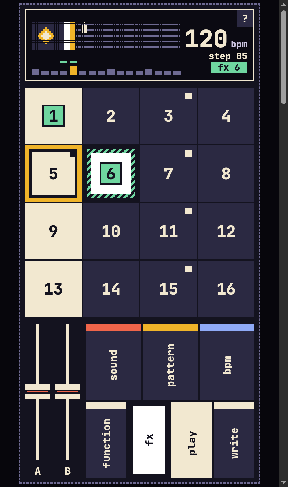
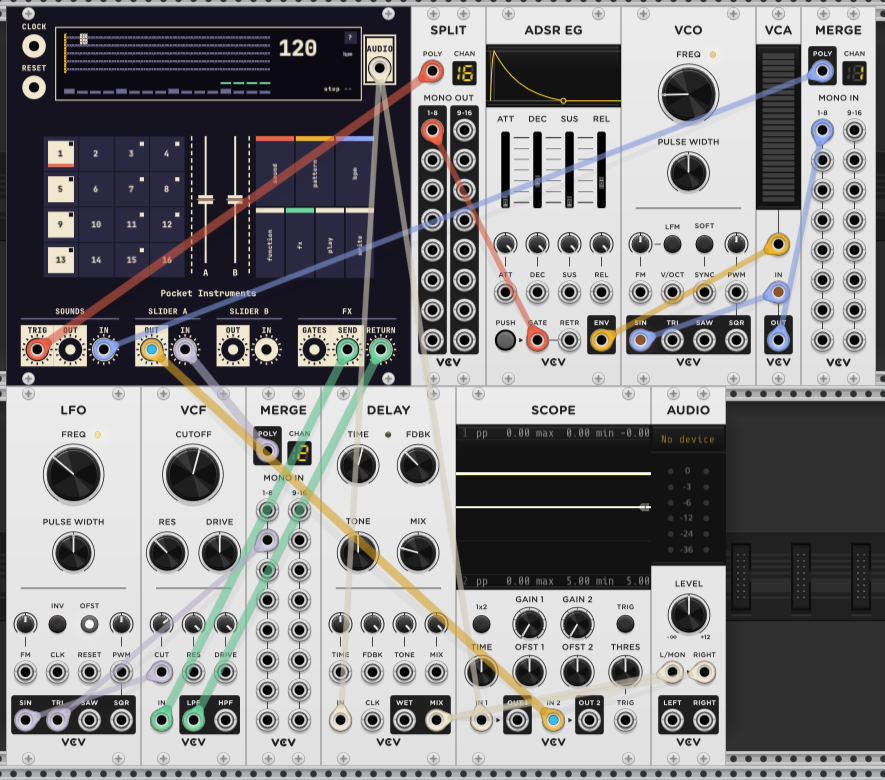
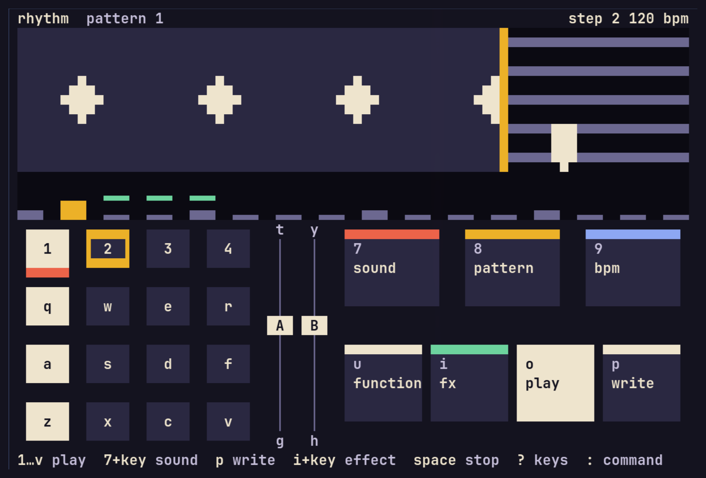
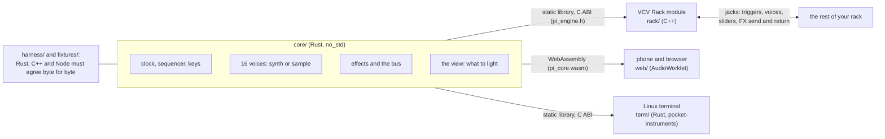

# Pocket Instruments

[](https://github.com/kinggs/pocket-instruments/actions/workflows/test.yml)
[](https://github.com/kinggs/pocket-instruments/actions/workflows/rack.yml)

Small calculator-format musical instruments, free and open source, that play in a browser, as
VCV Rack modules and in a Linux terminal, from one shared engine.

<p align="center">
  
  &nbsp;
  
</p>

<p align="center">
  
</p>

<p align="center"><em>On a phone, in VCV Rack with the reference patch (<code>rack/patch/showcase.json</code>),
and in a terminal (<code>pocket-instruments rhythm</code> in foot).</em></p>

**Play it now:** <https://kinggs.github.io/pocket-instruments/web/rhythm.html> (made for a phone;
a desktop browser works too).

**In VCV Rack 2:** the plugin is not in the VCV Library. Test builds are on the
[Releases page](https://github.com/kinggs/pocket-instruments/releases), as pre-releases. They
are unsigned. To install one:

1. From the latest pre-release, download the `.vcvplugin` file for your computer: `win-x64`
   for Windows, `lin-x64` for Linux, `mac-arm64` for a Mac with Apple silicon (M1 and later),
   `mac-x64` for an Intel Mac. Download `Showcase.vcv` too.
2. In Rack, choose `Help > Open user folder`. Put the `.vcvplugin` file, as it is, in the
   folder there named `plugins-` and your platform (`plugins-win-x64`, `plugins-lin-x64`,
   `plugins-mac-arm64` or `plugins-mac-x64`). VCV's manual:
   [Installing](https://vcvrack.com/manual/Installing).
3. Restart Rack. It unpacks and loads the plugin when it starts.
4. Open `Showcase.vcv` in Rack and press HOLD on the button beside the LFO: both Rhythm modules play.

⚠ Not yet tried on a Mac: macOS may refuse an unsigned download
([issue 83](https://github.com/kinggs/pocket-instruments/issues/83)). Each file has a build
attestation: `gh attestation verify <file> -R kinggs/pocket-instruments` checks that this
repository's CI built it. Between releases, the latest green run of the
[rack workflow](https://github.com/kinggs/pocket-instruments/actions/workflows/rack.yml) has
the same files under "Artifacts" (sign in to GitHub). Or build it yourself (below).

**In a Linux terminal:** ⚠ the releases do not carry it yet; build it from a clone with `make term`
(below) and run `term/target/release/pocket-instruments`: it opens on a menu, and
`pocket-instruments rhythm` goes straight in. In a terminal that reports key-up (foot, kitty,
Ghostty, WezTerm) keys are held as on the hardware; elsewhere, tmux included, they tap.
`pocket-instruments --help` lists every key and the config file's settings. [docs/TERMINAL.md](docs/TERMINAL.md) has the detail.

## Why this exists

I love, love Teenage Engineering's pocket operators. This project is completely inspired by
them.

At the same time, I love the freedom of modular synths. So I wanted both. Then suddenly you get:

- **A full drum machine in your rack.** Sixteen sounds, each synthesised in code or played from
  a sample, sixteen steps, punch-in effects, the pocket operator's own way of playing.
- **Near-infinite patchability.** Every sound's trigger and audio goes out on its own channel
  and can come back in. Every effect has its own channel out and back. Replace the kick with
  your favourite oscillator, put a Rack filter where an effect was, drive the sliders from an
  LFO. Extend it and change it until it is yours.
- **And not only in Rack.** One Rust engine plays the same bits everywhere, so you can also
  have fun with it on a phone, in a browser, and in a Linux terminal / TUI.
- **A place to learn and practise.** The workflow stays close to the hardware: the same keys,
  the same combinations, the same order of doing things. What you learn here carries straight
  over to the real thing.

### Buy the real ones

Right now. Multiples of them! They are really amazing and so much fun:
**<https://teenage.engineering/products/po>**. Plain links, no affiliate links, nothing sold
here.

## Status

One instrument so far: **Rhythm**, a sixteen-step drum machine. It is an early build.

What plays today, on the page, in the Rack module and in the terminal:

- **Sixteen sounds**, one a key. Each is synthesised in code, or played from a public-domain
  sample if you choose that for a key.
- **Writing a beat** the way the hardware does: choose a sound, write its steps, play, set
  the tempo, swing and volume, clear the pattern. Recording live is not built yet.
- **Punch-in effects** (effects you hold a key to apply while the beat plays), recorded as
  you play them. Fourteen of the sixteen are built: a
  quarter-rate effect, distortion, bit crush, delay, four filters, four repeats, note shuffle
  and feedback. Effects 15 and 16 are not designed yet.
- **Two sliders** (pitch and length for the drums). A step keeps the slider values it was
  written with.
- **A display that weaves.** The screen draws the beat as cloth on a loom, growing as the
  beat plays.
- **In Rack, thirteen jacks.** Every sound's trigger, audio and slider voltages go out and come
  back in. Each effect has its own channel on two jacks, FX SEND (out) and FX RETURN (back
  in), so any effect can be ours or a Rack module's.

What does not yet:

- **One pattern only.** Sixteen patterns, copy and chains are the next piece of work.
- Much of the effect tuning is a first value, measured against one PO-12 and not yet judged by
  ear. The look is a stand-in until the maintainer, Kenny, rules
  on it.
- Not every proof has passed. A proof is a test with a pass bar set in advance. The iPhone and
  other-machine checks are part-run, and the feel (P8) and the look (P9) are open
  ([docs/PROOFS.md](docs/PROOFS.md)).

## What it is not

- **Not affiliated with or endorsed by Teenage Engineering.** Their names appear here only to
  describe what inspired this.
- **None of their material is in this repository.** No samples, firmware, artwork, photographs
  or logos.
- **Not a lookalike.** The look is our own, and is meant never to be mistaken for the original
  at a glance.
- **Never commercial.** Nothing here is sold.

## Why MIT

Anyone should be able to take this with no strings, Teenage Engineering included. A copyleft
licence would have let us copy code from GPL modules we admire. We do not need to. The
maintainer's reason: "the fun thing about modular is that I never want to lift their filters. I will just plug
a cable from us into their filter." In Rack, integration is a cable, not shared code.

## Inspirations and connected projects

[CREDITS.md](CREDITS.md) has the full list, with licences and what exactly is in the repository.

| Project | What we take |
|---|---|
| [Teenage Engineering's pocket operators](https://teenage.engineering/products/po) | The idea and the workflow. No material of theirs |
| [VCV Rack](https://vcvrack.com/) | The host the plugin is built for |
| [Surge XT for Rack](https://github.com/surge-synthesizer/surge-rack) (Surge Synth Team) | Ideas: how modulation shows on a control, how modules connect to neighbours. No code, no artwork |
| [sst-rackhelpers](https://github.com/surge-synthesizer/sst-rackhelpers) (Surge Synth Team, MIT) | A helper library for connecting to neighbouring modules. Decided, not adopted yet |
| [stmlib](https://github.com/pichenettes/stmlib) (Émilie Gillet, MIT) | Code: the effects' filter, ported to Rust, with her notice in `core/stmlib-plaits-MIT.txt` |
| [Plaits](https://github.com/pichenettes/eurorack) (Émilie Gillet, MIT) | An idea: effect 1 once ported its sample-rate reducer. That code is no longer in the core |
| [MindMeld MixMaster](https://github.com/MarcBoule/MindMeldModular) | Nothing taken. A mixer we want to patch into well. Today that takes VCV Split and sixteen cables |
| [Sonic Pi's bundled samples](https://github.com/sonic-pi-net/sonic-pi/blob/dev/etc/samples/README.md) (CC0, from [Freesound](https://freesound.org/) authors) | The sixteen starter samples. Each one's author and origin is in [samples/README.md](samples/README.md) |
| [JetBrains Mono](https://github.com/JetBrains/JetBrainsMono) (OFL 1.1) | The typeface, with its licence in `design/fonts/` |
| [Pocket Operations](https://shittyrecording.studio/) (Paul Wenzel) | A pattern book we admire. Nothing of it is in the repository. ⚠ Its licence is unread; a note to the author is drafted, not known to be sent |
| [VCSL](https://github.com/sgossner/VCSL) (Versilian Studios, CC0) | Samples to audition for the starter pack. Nothing used yet |
| [libpo](https://github.com/ericlewis/libpo) (Eric Lewis, MIT) | Being read. Nothing used yet |

## The design

The look is drawn in public, in Claude Design:

- **[The design canvas](https://claude.ai/artifact/Rswd7LH4BPVAPzA5r1AbxK)**, "Pocket Instruments: design": every board for the
  instruments, in pages (start here, Loom, Rhythm, the weave, Sampler and after, expanders).
  Each board is named proposed, ruled or built.
- **[Loom, the design system](https://claude.ai/artifact/EzTa2cGzc2duUV25f9Huo1)**: the colour tokens, the type and the rules. No
  components.

Where either differs from [design/DESIGN.md](design/DESIGN.md) or
[docs/DECISIONS.md](docs/DECISIONS.md), the repository is right.

## How it fits together

One engine, written once, in Rust: `no_std`, no allocator, no dependencies, and only `+ − × ÷`
on the sound path, so it gives the same bits on every host. It holds the whole instrument: the
clock, the sequencer, the keys and what they mean, the sixteen voices (synthesised, or played
from a sample), the effects, and a 64-byte view that says what each host should draw. A host
only passes in what a finger did and draws what it is told.



[docs/ARCHITECTURE.md](docs/ARCHITECTURE.md) has the detail, and
[docs/ENGINE.md](docs/ENGINE.md) the contract.

## How the repository is laid out

By host at the top. It is built for several instruments, and nothing is made generic until a
second instrument needs it.

| Folder | What it holds |
|---|---|
| `core/` | The engine: one Rust crate, `no_std`, no allocator, no dependencies |
| `rack/` | One VCV Rack plugin (slug `pocket-instruments`), a module an instrument: Rhythm, plus Probe, a test module |
| `web/` | One site, a page an instrument: `rhythm.html` |
| `term/` | The terminal host, `pocket-instruments`: its own Rust crate on the engine's static library |
| `harness/` | The same fixtures run through Rust, C++ and the `.wasm`, and compared |
| `fixtures/` | Test inputs and the exact output (the trace) each must produce |
| `samples/` | The starter drum pack and its origins |
| `design/` | The look: tokens, the panel, the font. The drawings themselves are on [the canvas](https://claude.ai/artifact/Rswd7LH4BPVAPzA5r1AbxK) |
| `docs/` | The design documents: `ENGINE.md` (the contract), `DECISIONS.md`, `REFERENCES.md`, `PROOFS.md`, `WORKFLOW.md`, `VOICES.md`, `LEARNINGS.md`, `RACK-RULES.md`. [docs/README.md](docs/README.md) maps them and explains the words and codes they use |
| `docs/history/` | `PLAN.md` and `PLAN-HISTORY.md`, frozen as they stood on 2026-11-26. The live backlog is the [issues](https://github.com/kinggs/pocket-instruments/issues) |

The root `index.html` is a small landing page. GitHub Pages serves the `main` branch as it is.

## Build and test

| For | You need |
|---|---|
| `make build`, `make test` | [mise](https://mise.jdx.dev/) (it installs the pinned Rust), make, a C++ compiler, binutils and a recent Node (⚠ the lowest version that works is not tested; v26 works). clang++ adds the ThreadSanitizer run |
| `make term` | ALSA's headers (`alsa-lib` on Arch, `libasound2-dev` on Debian and Ubuntu) and `pkg-config` |
| `make play`, `make p4`, `make listen` | `chromium` and `firefox` on the PATH |
| The Rack plugin | The Rack SDK 2.6.6 from <https://vcvrack.com/downloads>, kept outside the repository, and `jq` |

```sh
mise install     # once: the Rust this repository pins
make build       # the core, as a static library and as a .wasm
make test        # the fixtures through all three harnesses, compared byte for byte
make web         # after the core changes: copy the new .wasm into web/
make term        # the terminal host: term/target/release/pocket-instruments
```

`make test` takes about 40 seconds on the maintainer's laptop. It passed if it exited 0.

The Rack plugin:

```sh
make -C rack install RACK_DIR=/path/to/Rack-SDK   # builds the core and the plugin, installs it in Rack
make -C rack showcase RACK_DIR=/path/to/Rack-SDK  # rack/build/Showcase.vcv: the reference patch
```

The reference patch (`rack/patch/showcase.json`, written by `rack/patch/make-showcase.mjs`;
`Showcase.vcv` in each pre-release) uses only Rack's own modules, Core and Fundamental. It has
two Rhythm modules on one clock: DRUMS and MELODY.

**To start them in step,** press HOLD on the button beside the LFO (Fundamental's Push). Its
gate goes into both modules' PLAY in, so both start bar one on the next clock edge; press it
again and both stop. Each module's own play key still plays that module alone. The rule for
PLAY in (a gate plays while high, a short trigger toggles) is D138's, proposed (O39) ⚠.

The drums are one bar: the first bar of the Amen break written out on Rhythm's own sounds (no
recording of the record). The four-bar version follows once the instrument holds more than one
pattern. The rows, each left to right in signal order:

- **Drums and out.** A note. **LFO:** the clock, one edge a step at 136 bpm, into both
  modules' CLOCK and both Delays. **Push:** its gate into both modules' PLAY in. **Rhythm (DRUMS):** kick
  and snare on their samples, hats in code; the ghost snares written short. **Split** and
  **Delay:** effect 4 (below). **VCA Mix:** a fader for each module. **Audio 2:** the mix to
  both ears. Choose your device on it.
- **Melody.** A note. **Rhythm (MELODY):** no drums. Its sound 15 plays the lead and sound 16
  the bass, and each of their steps keeps its own sliders A and B. **Split** ×3 take apart
  SOUNDS TRIG, SLIDER A OUT and SLIDER B OUT. **Merge:** both voices back into SOUNDS IN on
  channels 15 and 16, so Rhythm plays them in place of its own sounds 15 and 16, once, and its
  effects reach them. **Split** and **Delay:** effect 4.
- **Lead.** A note. **Random:** a new voltage on each trigger. **8vert:** down to ±1 V, two
  octaves. **Quantizer:** A C D E G (A minor pentatonic, with the VCO's tuning). **VCO:** the
  saw. **VCF:** slider A, set per step: the filter opens across the bar. **ADSR** and
  **VCA-1:** slider B, set per step, is how long each note rings.
- **Bass.** A note. **8vert** and **Quantizer:** slider A, set per step, is the note (A, C, E,
  G). **VCO:** the square, two octaves down. **VCF:** slider B, set per step. **ADSR** and
  **VCA-1:** short notes.

**Effect 4, the delay, is Rack's** on both modules. Each module's menu has effect 4 on "Rack's,
beside the dry": the built-in delay stays silent and the dry stays in the mix. FX SEND's
channel 4 carries sound only while effect 4 is heard, Split takes it out, and Delay's wet
output goes back in on FX RETURN. The echo is a dotted eighth, kept to the clock. The lanes
play it on set steps: the drums' backbeat snare on step 13, and the melody on steps 4, 5, 14
and 15. Hold fx and press 4 to throw it by hand.

To play the page from a clone, run `make hear` and open
`http://127.0.0.1:8417/web/rhythm.html`. Any static file server on the repository root works
too.

## Contributing

Work goes through pull requests: CI must pass, and merges are squashed.
[CONTRIBUTING.md](CONTRIBUTING.md) has the rules. The short version: design comes before a build
(a change to `docs/ENGINE.md` and a decision in `docs/DECISIONS.md`), and a build decides
nothing. Agents are welcome contributors. [AGENTS.md](AGENTS.md) has the map, the commands and
how to work an issue, for people and agents alike. The
backlog is the [issues](https://github.com/kinggs/pocket-instruments/issues). The reasons behind
everything are in [docs/](docs/).

## Licence

[MIT](LICENSE). Copyright (c) 2026 Kenny Inggs and the Pocket Instruments contributors.
Third-party notices are in [CREDITS.md](CREDITS.md).
